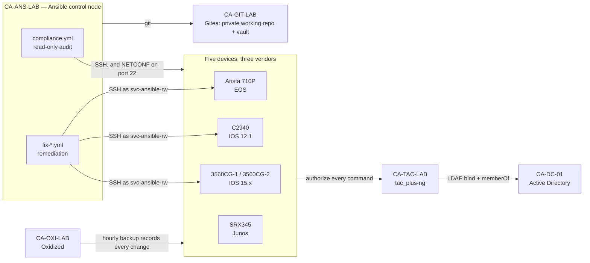

# Network Automation — Compliance and Remediation Across Three Vendors

> Part of [CASEY-LAB](https://github.com/117caseyallen-NetAdm/casey-lab), a
> dual-site multi-vendor homelab. Builds on
> [homelab-tacacs-aaa](https://github.com/117caseyallen-NetAdm/homelab-tacacs-aaa),
> which provides the identities and permissions everything here runs under.

An Ansible control node audits five network devices — **Cisco IOS 15.x and a
2003-era 12.1, Arista EOS and Juniper Junos** — against a baseline written as
data, fixes what fails, and audits again to prove the fix landed.

It makes changes as a service account whose permissions are a short allowlist
enforced by the TACACS+ server **one command at a time**. A playbook that asks
for anything outside the list is refused by the server, whatever the YAML
says. The playbook is not the security boundary; the AAA server is.

The first automated change, as the AAA server authorized it:

```text
10.99.20.1  svc-ansible-rw  deploy  permit  shell  show running-config <cr>
10.99.20.1  svc-ansible-rw  deploy  permit  shell  configure terminal <cr>
10.99.20.1  svc-ansible-rw  deploy  permit  shell  no ip http server <cr>
10.99.20.1  svc-ansible-rw  deploy  permit  shell  no ip http secure-server <cr>
10.99.20.1  svc-ansible-rw  deploy  permit  shell  copy running-config startup-config <cr>
10.99.20.1  svc-ansible-rw  deploy  permit  shell  show running-config <cr>
```

Read, change, save, read back. And the same change as the backup system
recorded it, independently, on its next hourly poll — each commit's diff lines
condensed onto one row:

```text
update /3560CG-2    -ip http server   -ip http secure-server   +no ip http server   +no ip http secure-server
update /3560CG-1    -ip http server   -ip http secure-server   +no ip http server   +no ip http secure-server
update /C2940-LAB   -ip http server                            +no ip http server
```

The C2940 has no HTTPS server to turn off. How that was discovered is
[finding 7](docs/findings.md#7---check-proves-intent-not-feasibility).



## Audit, fix, verify

| | Where the fleet stood |
| --- | --- |
| First audit | No IOS or EOS device forwarding syslog, and the HTTP server running on every Cisco — a default nobody had chosen |
| After two remediations | **19/20 · 19/20 · 18/20 · 11/11 · 10/10** |

The remaining failures are two credentials — an `enable secret` still hashed
with MD5 on the two 3560s, and a leftover local account on the C2940. They are
left for a person on purpose: credentials don't go through the pipeline.

The loop, once per kind of change:

1. **The audit finds it.** `compliance.yml` reads each running configuration
   and evaluates it against a list of checks. Nothing in it can change a device.
2. **A playbook fixes it**, dry run first. `--check --diff` on one device, then
   the same device for real, then again to confirm it reports no change, then
   the fleet.
3. **The audit confirms it.** Same playbook, same checks. The failure is gone or
   the fix didn't work.

Idempotence is what makes this safe to repeat: in a single fleet run, the
device that was already correct reported `ok` and was left alone, and the two
that weren't reported `changed`.

## Policy is data

The checks aren't tasks. They're a list per platform in
[`inventory/group_vars/`](inventory/group_vars/), and
[`compliance.yml`](playbooks/compliance.yml) is a small engine that reads the
configuration once and loops the list. Adding a check is one line of YAML.

Three checks exist because the TACACS+ build found the underlying problem the
hard way, and a test can't regress the way a paragraph can:

```yaml
  # Leaving "password" in the order made Junos fall through to local auth on
  # an explicit REJECT. Absence of this line IS the fix.
  - name: Local password is NOT in the authentication order
    regex: '(?m)^set system authentication-order password'
    expect: absent
```

**Every check is PASS, FAIL or EXCEPTION.** An exception is a failure accepted
in writing, in [`inventory/host_vars/`](inventory/host_vars/), with a reason
and an **expiry date**. On that date it becomes a failure again, so nothing is
excused forever. An exception whose check has started passing is reported as
**STALE** and should be deleted:

```yaml
compliance_exceptions:
  - name: Local secrets are not type 5 (MD5)
    reason: >-
      IOS 12.1(22)EA13 supports neither type 8 (PBKDF2) nor type 9 (scrypt).
      No upgrade path exists for this hardware. Mitigated by access-list 10,
      which restricts management access to four source ranges.
    expires: "2027-09-24"
```

**The gate demands evidence.** `-e compliance_gate=true` makes a non-compliant
fleet exit non-zero, for CI. Its first version asserted "no failures" — and
passed a device that had failed to report *anything*: zero failures out of zero
checks. It now requires that checks actually ran.

**Running config must equal startup config.** An audit that reads only the
running config can be fooled by a change that was never saved: it passes, then
a reload undoes it. That happened here. The comparison filters header noise
that was *observed* on every platform before the filter was written, not
guessed — the C2940 turned out to be the only device whose `ntp clock-period`
drifts, and a filter written from the newer switches would have failed on it
forever.

## The AAA server is the boundary

| Account | AD group | TACACS+ profile | Used for |
| --- | --- | --- | --- |
| `svc-ansible-ro` | `NetOps` | `readonly` — `show` and session setup only | the audit, once CI runs it |
| `svc-ansible-rw` | `NetDeploy` | `deploy` — an allowlist | remediation only |

The `deploy` profile is scoped by **command**, not by privilege level.
Privilege 15 with no command rules is root. The allowlist is the written record
of what automation is permitted to touch, and it grows one payload at a time:

```text
if (cmd =~ /^(no )?ip http (secure-)?server( ?<cr>)?$/) permit    # payload 1
if (cmd =~ /^(no )?logging host /)                     permit    # payload 2
if (cmd =~ /^(no )?logging [0-9]/)                     permit    # payload 2, IOS 12.1 syntax
```

Proven from both ends. On the server, a validator asserts 34 answers with no
device involved — including eight things the deploy account must be refused,
from `username` to `erase startup-config` to a shell on the switch. On the
devices, a real session:

```text
10.99.20.1  svc-ansible-rw  deploy  permit  shell  configure terminal <cr>
10.99.20.1  svc-ansible-rw  deploy  deny    shell  clear counters <cr>
10.99.20.1  svc-ansible-rw  deploy  deny    shell  interface GigabitEthernet 0 8 <cr>
10.99.20.1  svc-ansible-rw  deploy  permit  shell  write memory <cr>
```

That result took two fixes. The profile's `$`-anchored patterns never matched a
real device, and — worse — the switches weren't asking the server about
configuration-mode commands at all, so for a while this account was root on
every IOS device. [Finding 6](docs/findings.md#6-the-allowlist-had-two-defects-failing-in-opposite-directions)
has both.

## Same tool, four platforms

| | IOS 15.x | IOS 12.1 | EOS | Junos |
| --- | --- | --- | --- | --- |
| Connection | SSH | SSH | SSH | **NETCONF over port 22** |
| SSH it forces | SHA-1 key exchange | `group1-sha1`, `3des-cbc` | modern | modern |
| Configuration model | line by line, applied as typed | same | **sessions** when Ansible drives it, committed atomically | candidate, committed atomically |
| What `--check` proves | the diff Ansible computed locally | same | a diff **the switch** generated, then discarded | — |
| Writes | `ios_config` | `ios_config`, with capability flags | `eos_config`, via sessions | none yet: audit only |

The `--check` row is the one to remember. On IOS it proves intent, not that the
device will accept the commands; on EOS the device itself validated them.

## What didn't go to plan

The findings worth reading are the ones that broke something. Full write-ups
with evidence in **[docs/findings.md](docs/findings.md)**.

- **The deploy account was root, and nothing in the config said so.**
  `aaa authorization commands 15` covers exec commands only; configuration
  mode needs `aaa authorization config-commands`, and on these switches its
  absence meant *off*. The authorization log recorded two entries for a session
  that went on to create a local user, and a later session used the same hole to
  reconfigure AAA itself. Found only by typing commands on real hardware — the
  server-side test would have passed forever.
- **The automation library asked for a root shell.** During device discovery,
  Arista's Ansible collection requests `bash timeout 5 cat /mnt/flash/boot-config`.
  On EOS, `bash` is a shell on the underlying Linux. Deny-by-default refused it,
  the collection carried on without it, and it is now an asserted refusal in the
  validator. Nobody would have written that rule in advance.
- **`--check` proves intent, not feasibility.** The dry run reported two
  commands for the C2940; the real run failed on the second, because a 2003
  image has no HTTPS server to disable. IOS isn't transactional, so the first
  line was already applied — and because the task failed, nothing was saved.
  The audit would have gone green and a reload would have undone it.
- **The visible error wasn't the failure.** The first Arista run failed with
  `end` / `% Invalid input` at an exec prompt. The AAA log showed what actually
  broke first: `eos_config` opens a configuration *session*, which wasn't on the
  allowlist. The allowlist was widened by exactly the strings the log showed.
- **The first audit failed the same four checks on every device** — including
  two vendors whose checks were written independently. Uniform failure across
  independent platforms means the tests are wrong, and they were: the devices
  used a named server group, and the regexes demanded the literal `tacacs+`.
- **The fix for the oldest switches was stricter than it needed to be.**
  `paramiko` 5 deleted every SHA-1 key exchange, which three of these five
  devices require, so the control node pinned `paramiko<3` — and then
  `ncclient<0.7`, because current `ncclient` needs a newer `paramiko`. A later
  check found `paramiko` 3.5 and 4.0 still negotiate with every switch here. The
  pin was costing a security fix and a current NETCONF library for nothing.

## What's here

```text
ansible.cfg
requirements.txt              pinned, with the reason for each pin
inventory/
  hosts.yml                   five devices, grouped by platform
  group_vars/
    all.yml                   the baseline: what "compliant" means, once
    ios.yml eos.yml junos.yml the checks, as data
  host_vars/
    C2940-LAB.yml             an exception with an expiry, and capability flags
playbooks/
  facts.yml                   inventory the fleet: model, version, interfaces
  compliance.yml              the audit
  fix-http-server.yml         payload 1
  fix-syslog.yml              payload 2
  tasks/read-config.yml       one running-config read, whatever the platform
vault/
  deploy.yml.example          the shape of the vault; the real one never leaves the private repo
docs/
  findings.md                 what broke, with evidence
  build-notes.md              each stage, ending in the check that proved it
  verification.md             the output behind every claim here
```

## Running it

```bash
# Audit - read-only
ansible-playbook playbooks/compliance.yml --ask-pass
ansible-playbook playbooks/compliance.yml --ask-pass -e compliance_gate=true   # exit non-zero if non-compliant

# Remediate - dry run, then one device, then the fleet
ansible-playbook playbooks/fix-syslog.yml --ask-vault-pass --check --diff --limit 3560CG-2
ansible-playbook playbooks/fix-syslog.yml --ask-vault-pass --limit 3560CG-2
ansible-playbook playbooks/fix-syslog.yml --ask-vault-pass
```

`-e debug_config=true` lifts `no_log` on the configuration reads for one run.
It exists because `no_log` censors failures as well as secrets, which makes a
broken read undiagnosable. It prints secrets to the terminal, so it is for
interactive use only.

`ansible-lint` passes at its strictest profile, `production`, and every
playbook passes `--syntax-check` under the pinned environment.

## Limits, stated plainly

- **It runs by hand.** A Gitea Actions runner — lint, audit on every push, a
  gated apply behind a button, and a nightly audit to catch drift — is next.
- **Junos is audit-only.** Junos doesn't use per-command TACACS+ authorization;
  its equivalent is a login class with `allow-configuration-regexps`, which
  doesn't exist yet. The `deploy` profile denies Junos until it does. The
  PA-440 isn't covered at all: PAN-OS is managed through its XML API, not SSH.
- **The audit still runs as a person.** `svc-ansible-ro` exists; wiring it in
  needs its own vault, under a separate vault ID, so that an audit job can never
  unlock the deploy credential.
- **The vault is loaded when a playbook is parsed.** `vars_files` means even
  `--syntax-check` needs the vault password, so the CI plan's "lint with no
  credentials" step isn't credential-free yet. The fix is to load it inside a
  task.
- **`paramiko<3` forgoes the Terrapin mitigation** (CVE-2023-48795, added in
  paramiko 3.4) on every connection, and holds `ncclient` back a major version.
  Neither is necessary: 3.5 and 4.0 both negotiate with the legacy switches.
  Moving the pin to `>=3.4,<5` and releasing `ncclient` is the fix, once a full
  run has been tested against it — a handshake is not a playbook.
- **`host_key_checking = False`.** Device host keys aren't pinned, so a
  man-in-the-middle on the management VLAN wouldn't be detected. The management
  VLAN is the trust boundary; pinning the keys is the proper fix.
- **Checks are regular expressions over configuration text.** A device that is
  correct in an unexpected form fails; one that is wrong in a form nobody
  anticipated could pass. Every check was written against real output, and the
  riskiest was deliberately made to fail before it was trusted.
- **3560CG-1's syslog arrives from its transit link**, not its management
  address, so the collector can't name it. The fix is
  `logging source-interface`, which isn't on the allowlist yet.

---

*Internal RFC1918 addressing and hostnames are real. No credentials, keys,
public addresses, or device configurations appear in this repository.*
